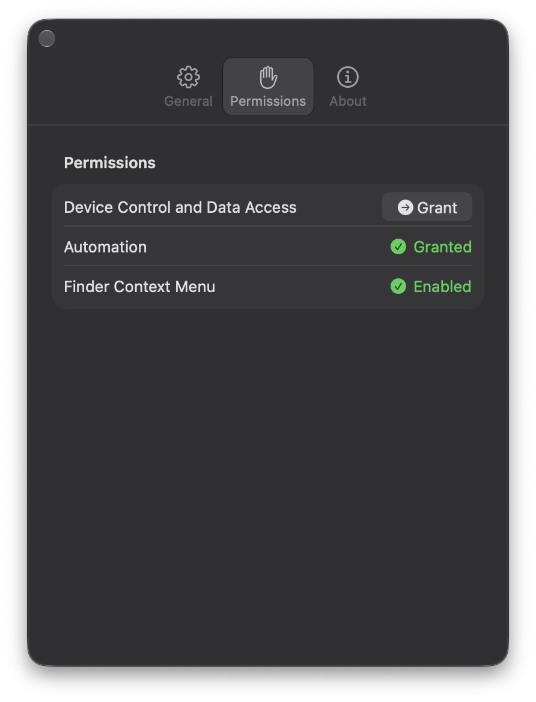

<div align="center">
  
  <h1>Buckle</h1>
  <p>Everyday Mac tools, a click away.</p>
  <p><strong>English</strong> · <a href="docs/README.zh-CN.md">简体中文</a> · <a href="docs/README.zh-TW.md">繁體中文</a> · <a href="docs/README.ja.md">日本語</a> · <a href="docs/README.ko.md">한국어</a> · <a href="docs/README.de.md">Deutsch</a> · <a href="docs/README.fr.md">Français</a> · <a href="docs/README.es.md">Español</a></p>
</div>

Buckle is a native macOS menu-bar app for system tools, launching browsers in another language, and everyday Finder actions. It runs in the background without a Dock icon.

**[Download for macOS](https://github.com/SlippinDylan/Buckle/releases/latest)** · [Development guide](docs/development.md)

> [!NOTE]
> This README describes the current source code. Downloadable builds follow the features and limitations listed in their release notes.

## Install and first use

Requires **macOS 15 or later**, on Apple Silicon or Intel. CI builds target Universal 2.

1. Download `Buckle-<version>.dmg` from the [latest GitHub Release](https://github.com/SlippinDylan/Buckle/releases/latest). Choose the installer under **Assets**; the source-code archives are for development.
2. If upgrading, choose **Quit** from the running Buckle menu and wait for it to exit. Open the DMG and drag `Buckle.app` into **Applications**, replacing the previous copy if needed.
3. Open `/Applications/Buckle.app`. Buckle appears in the menu bar, without a Dock icon. Keep one installed copy.
4. Use the menu-bar menu to run tools or enable Finder actions. All four Finder actions are off on first use; your selections are saved.
5. Open **Settings → Permissions** to enable the Finder extension or grant requested access. Status refreshes automatically; green text and a checkmark indicate granted access or an enabled extension.

> [!IMPORTANT]
> Builds use ad-hoc signing and are not notarized. A downloaded build may need approval in System Settings; system permissions may need to be granted again after an update.

## What you can do

<table>
  <tr>
    <td width="36%"><strong>System tools in the menu bar</strong><br><br>Open the system memory window, reset mouse utilities with progress and results, or restart the system menu bar. Finder actions can be toggled individually; a checkmark means enabled.</td>
    <td width="64%" align="center"></td>
  </tr>
  <tr>
    <td width="36%"><strong>Finder actions, where you need them</strong><br><br>Add AirDrop, Open in Terminal, Copy Path, and Move Items Here directly to Finder’s context menu. Open Terminal in the selected folder or current folder; copy multiple paths as separate lines.</td>
    <td width="64%" align="center"></td>
  </tr>
  <tr>
    <td width="36%"><strong>Launch browsers in eight languages</strong><br><br>Choose an installed browser, then a language. Buckle detects supported browsers whenever you open the menu. Launching uses app code, with no personal scripts required.</td>
    <td width="64%" align="center"></td>
  </tr>
</table>

## Settings

Manage launch at login and app language under **Settings → General**. The interface follows macOS by default, or you can choose English, Simplified Chinese, Traditional Chinese, Japanese, Korean, German, French, or Spanish. Restart Buckle to apply a language change.

Under **Settings → Mouse Reset**, you can add or remove applications and set the delay before reopening them: 0–60 seconds, with a default of 3 seconds. Changes are saved automatically; editing is disabled during a reset.

<p align="center">
  
  
</p>

Screenshots show the English interface and may differ from your installed version. Menus vary with installed browsers, enabled actions, and copied files.

## Before you use the tools

- **Memory window:** opens macOS LowMemoryPanel manually, including at normal memory usage. Its built-in “out of application memory” message is not a diagnosis. This uses a private system debug path. Buckle checks for the specific memory warning window, restores its temporary setting, and reports failure if it cannot confirm the window. Compatibility still requires testing on each macOS version. Accessibility and System Events automation access are required; there is no background memory monitoring.
- **Reset Mouse:** manage the application list under **Settings → Mouse Reset**; defaults are Moom, MonitorControl, BetterMouse, and iShot Pro. Each reset quits the running apps in your list, refreshes shared macOS preference and permission services, then reopens those apps. Only apps that were already running are reopened. Service refresh can briefly affect other apps and requires administrator authorization. Uninstalled apps are skipped; service refresh still runs when the list is empty. Pending recovery is saved: after an interruption, the next launch offers to reopen the apps; choosing Later keeps the record.
- **Restart System Menu Bar:** restarts your SystemUIServer without sudo. It may not fix icons owned by other apps.
- **Browser profiles:** uses the browser’s existing data and saved sign-ins, without creating a separate profile. Profile selection follows the browser’s own behavior. Quit the browser before changing its launch language; Buckle only shows a notice if it is already running. Japanese launches request the Tokyo time zone for the browser process, matching the original script; other languages keep the system time zone. This does not change macOS settings or your IP address, or guarantee a website’s language or regional formatting. Time-zone behavior has been verified only with Chrome Beta.
- **Finder:** Copy Path works in the extension; other actions launch Buckle when needed. For Move Items Here, first copy files in Finder, then right-click the destination folder or its background. Moves require confirmation, never replace existing items, and have no Finder Undo integration. A partial failure leaves completed moves in place; check both folders before retrying. Finder controls menu placement. Custom Finder menu labels follow Buckle’s language after restarting Buckle; the native AirDrop label follows the system.
- **Updates:** Sparkle is integrated. Manual checks are under **Settings → About**, automatic checks under **General**. Development and pull request builds disable updates; main CI release builds enable them; online updates require a published installer and signed feed.

## Build from source

<details>
<summary>Show source-build and development steps</summary>

Requires Xcode 26 or later, Node.js, and Python 3. Debug builds need no Apple developer account.

```bash
git clone https://github.com/SlippinDylan/Buckle.git
cd Buckle
bash Scripts/check.sh
bash Scripts/build.sh Debug
```

After building, choose one of the following workflows.

### Install for everyday use

Quit any running Buckle using **Quit** in its menu-bar menu and wait for it to exit. In Finder, move the entire `Buckle.app` from `build/DerivedData/Build/Products/Debug/` to `/Applications`; if replacing an installed copy, do so only after it has quit. Open `/Applications/Buckle.app` and keep one installed copy.

### Run for development

Quit any running Buckle using **Quit** and wait for it to exit before opening the build below. Alternatively, open `Buckle.xcodeproj` and run the `Buckle` scheme in Debug after quitting the existing app. Buckle allows only one running instance: a newly launched process exits if another copy is still running. During development, use the build you are testing rather than also opening the installed copy.

```bash
open build/DerivedData/Build/Products/Debug/Buckle.app
```

</details>

## Developer documentation

See the [development guide](docs/development.md) (Chinese) for architecture, checks, CI packaging, update publishing, signing, and on-device acceptance. [GitHub Releases](https://github.com/SlippinDylan/Buckle/releases) contains published installers; [release notes](CHANGELOG.md) are maintained in English.
