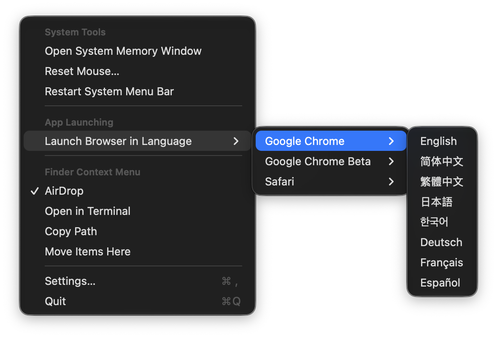

<div align="center">
  
  <h1>Buckle</h1>
  <p>Alltägliche Mac-Werkzeuge, nur einen Klick entfernt.</p>
  <p><a href="../README.md">English</a> · <a href="README.zh-CN.md">简体中文</a> · <a href="README.zh-TW.md">繁體中文</a> · <a href="README.ja.md">日本語</a> · <a href="README.ko.md">한국어</a> · <strong>Deutsch</strong> · <a href="README.fr.md">Français</a> · <a href="README.es.md">Español</a></p>
</div>

Buckle ist eine native macOS-Menüleisten-App für Systemwerkzeuge, Browserstarts in einer anderen Sprache und häufige Finder-Aktionen. Sie läuft im Hintergrund ohne Dock-Symbol.

**[Für macOS herunterladen](https://github.com/SlippinDylan/Buckle/releases/latest)** · [Entwicklungsleitfaden](development.md)

> [!NOTE]
> Diese README beschreibt den aktuellen Quellcode. Für heruntergeladene Versionen gelten die Änderungen und Einschränkungen in den jeweiligen Versionshinweisen.

## Installation und erster Start

Erfordert **macOS 15 oder neuer** auf Apple Silicon oder Intel. CI-Builds zielen auf Universal 2.

1. Lade `Buckle-<version>.dmg` unter **Assets** der [neuesten GitHub-Version](https://github.com/SlippinDylan/Buckle/releases/latest) herunter. Die Quellcodearchive dienen der Entwicklung und sind keine Installationspakete.
2. Wähle bei einem Update zuerst „Beenden“ im Menü des laufenden Buckle und warte auf das Ende. Öffne das DMG und ziehe `Buckle.app` nach „Programme“. Ersetze bei Bedarf die bisherige Kopie.
3. Öffne `/Applications/Buckle.app`. Buckle erscheint in der Menüleiste ohne Dock-Symbol. Behalte nur eine installierte Kopie.
4. Nutze die Werkzeuge oder aktiviere Finder-Aktionen über die Menüleiste. Alle fünf Finder-Aktionen sind anfangs ausgeschaltet; deine Auswahl wird gespeichert.
5. Aktiviere unter **Einstellungen → Berechtigungen** die Finder-Erweiterung und erteile angeforderte Zugriffe. Der Status wird automatisch aktualisiert; grüne Schrift und ein Häkchen zeigen erteilte Rechte oder eine aktive Erweiterung.

Wenn du den Einrichtungsassistenten noch nicht geschlossen oder abgeschlossen hast, erscheint er einmal beim normalen Start – auch für bestehende Nutzer. Vorhandene Einstellungen bleiben erhalten. Er erklärt die Menüleiste und bietet Finder-Aktionen mit den nötigen Berechtigungen, den Start bei der Anmeldung und die automatische Update-Suche an. Änderungen werden sofort gespeichert. Die fünf Finder-Aktionen bleiben aus, bis du sie auswählst. Du kannst ohne Berechtigung fortfahren, das Fenster schließen; nach einem Neustart oder Update öffnet sich der Assistent nicht erneut automatisch. Wenn neue Nutzer die Update-Auswahl überspringen, bleibt die automatische Suche aus. Vorhandene Update-Einstellungen bleiben erhalten; Builds mit Update-Unterstützung erlauben weiterhin die manuelle Suche. Die Abschlussseite erscheint im selben Fenster; über die Schaltfläche zum Loslegen öffnest du das Buckle-Menü. Berechtigungen stehen auf einer eigenen Seite vor den Funktionsschaltern; du kannst auch ohne Freigabe fortfahren.

> [!IMPORTANT]
> Die Builds sind ad-hoc-signiert und nicht notarisiert. Heruntergeladene Builds benötigen möglicherweise eine Freigabe in den Systemeinstellungen; nach einem Update können erneute Berechtigungen nötig sein.

Die Installation über Homebrew ist noch nicht verfügbar. Verwende die DMG, bis der Buckle-Cask im [gemeinsamen Tap](https://github.com/SlippinDylan/homebrew-tap) veröffentlicht wurde.

## Deinstallieren und neu installieren

Beende Buckle über das Menü und warte, bis es beendet ist. Verschiebe dann `Buckle.app` in den Papierkorb. Beim Löschen der App bleiben Einstellungen und der Einrichtungsstatus erhalten. Überschreiben oder Neuinstallieren zeigt den Assistenten deshalb nicht erneut an.

Damit der Assistent nach einer Neuinstallation wieder erscheint, führe nach dem Beenden von Buckle zusätzlich diesen Befehl im Terminal aus:

```bash
defaults delete studio.slippindylan.Buckle onboarding.dismissed
```

Der Befehl entfernt nur den Eintrag zum Schließen des Assistenten. Andere Einstellungen, Finder-Daten und Systemberechtigungen bleiben erhalten. Existiert der Eintrag nicht, ist nichts zu entfernen. Starte Buckle nach der Neuinstallation manuell; der Assistent erscheint einmal. Führe den Befehl bei einem normalen Update nicht aus.

## Funktionen

<table>
  <tr>
    <td width="36%"><strong>Systemwerkzeuge in der Menüleiste</strong><br><br>Öffne das Systemfenster zur Speichernutzung, setze Maus-Hilfsprogramme mit Fortschritts- und Ergebnisanzeige zurück oder starte die Systemmenüleiste neu. Finder-Aktionen lassen sich einzeln umschalten; ein Häkchen bedeutet aktiviert.</td>
    <td width="64%" align="center"></td>
  </tr>
  <tr>
    <td width="36%"><strong>Aktionen direkt im Finder</strong><br><br>Ergänze das Finder-Kontextmenü um AirDrop, Im Terminal öffnen, Pfad kopieren, Objekte hierherbewegen und Neue Textdatei. Das Terminal öffnet sich im ausgewählten oder aktuellen Ordner; mehrere Pfade werden zeilenweise kopiert.</td>
    <td width="64%" align="center"></td>
  </tr>
  <tr>
    <td width="36%"><strong>Browser in acht Sprachen starten</strong><br><br>Wähle einen installierten Browser und anschließend eine Sprache. Buckle erkennt unterstützte Browser bei jedem Öffnen des Menüs. Der Start erfolgt direkt durch die App, ohne persönliche Skripte.</td>
    <td width="64%" align="center"></td>
  </tr>
</table>

Die vier eigenen Finder-Aktionen verwenden im Finder und im Menü von Buckle dieselben farbigen Symbole; AirDrop behält sein Systemsymbol.

**Neue Textdatei:** Aktiviere die Aktion in der Menüleiste oder Einrichtung und klicke mit rechts auf einen einzelnen gewöhnlichen Ordner oder dessen Hintergrund. Buckle erstellt eine leere `.txt`-Datei mit lokalisiertem Namen, ergänzt bei Namenskonflikten eine Nummer ohne Überschreiben und wählt sie im Finder aus. Dafür ist die Finder-Erweiterung nötig, ohne zusätzliche Bedienungshilfen- oder Automatisierungsberechtigung. Automatisches Umbenennen und das native Widerrufen im Finder werden nicht angeboten.

## Einstellungen

Unter **Einstellungen → Allgemein** verwaltest du den Start bei der Anmeldung und die App-Sprache. Standardmäßig folgt sie macOS. Zur Auswahl stehen Englisch, vereinfachtes und traditionelles Chinesisch, Japanisch, Koreanisch, Deutsch, Französisch und Spanisch. Sprachänderungen werden nach einem Neustart von Buckle wirksam.

Aktiviere unter **Einstellungen → Allgemein → Dock** die Option **Apps per Mittelklick beenden** (standardmäßig aus) und klicke mit der mittleren Maustaste auf eine laufende App im Dock. Derselbe Schalter ist auch in der Menüleiste verfügbar. Das Untermenü **Mittelklick-Aktion** speichert **Normal beenden** (Standard) oder **Sofort beenden…**; beim Klicken öffnet sich kein Aktionsmenü. Normales Beenden erlaubt Sichern oder Abbrechen. Sofortiges Beenden verlangt jedes Mal eine Bestätigung mit Warnung vor dem Verlust ungesicherter Änderungen; Abbrechen bewirkt nichts. Nach Bestätigung prüft Buckle dieselbe App-Instanz erneut und beendet nur diese App, ohne alle Hilfsprozesse zu beenden, automatisch zu eskalieren, erneut zu versuchen oder zusätzliche Berechtigungen anzufordern. Finder, Dock, WindowManager und Buckle sind ausgeschlossen. Bedienungshilfen-Zugriff ist nötig; startet der Mausfilter nicht, bietet die Einstellung eine ausdrückliche Anfrage zur Eingabeüberwachung. Ziehen beendet keine App; ein schneller erster Klick kann während der Symbolerkennung durchgereicht werden. Beide neuen Funktionen müssen noch mit einer installierten Version auf unterstützten macOS-Versionen getestet werden. macOS 15 ist das Mindestziel, kein bestätigtes Kompatibilitätsergebnis.

Unter **Einstellungen → Maus-Reset** kannst du Programme hinzufügen oder entfernen und die Wartezeit vor dem erneuten Öffnen auf 0–60 Sekunden einstellen. Standard sind 3 Sekunden. Änderungen werden automatisch gespeichert; während eines Resets ist die Bearbeitung gesperrt.

<p align="center">
  
  
</p>

Die Screenshots zeigen die englische Oberfläche und können von deiner installierten Version abweichen. Menüs hängen von Browsern, aktivierten Aktionen und kopierten Dateien ab.

## Hinweise zur Verwendung

- **Speicherfenster:** öffnet macOS LowMemoryPanel manuell, auch bei normaler Speichernutzung. Der eingebaute Speicherwarntext ist keine Diagnose von Buckle. Die Funktion nutzt einen privaten System-Debug-Pfad. Buckle prüft das konkrete Speicherwarnfenster, stellt die temporäre Einstellung wieder her und meldet einen Fehler, wenn das Fenster nicht bestätigt werden kann. Die Kompatibilität muss je macOS-Version getestet werden. Bedienungshilfen und System Events-Automatisierung sind erforderlich; es gibt keine Hintergrundüberwachung.
- **Maus zurücksetzen:** Verwalte die Programmliste unter **Einstellungen → Maus-Reset**. Die Standardliste enthält Moom, MonitorControl, BetterMouse und iShot Pro. Bei jedem Vorgang werden laufende Programme aus der Liste beendet, die gemeinsamen macOS-Einstellungsdienste und systemweiten Berechtigungsdienste aktualisiert und die Programme wieder geöffnet. Nur zuvor laufende Programme werden erneut geöffnet. Die Dienstaktualisierung kann andere Programme kurz beeinflussen und erfordert Administratorrechte. Deinstallierte Programme werden übersprungen; auch bei leerer Liste werden die Dienste aktualisiert. Ausstehende Wiederherstellungen werden gespeichert. Nach einer Unterbrechung fragt Buckle beim nächsten Start, ob die Programme wieder geöffnet werden sollen; „Später“ behält den Eintrag.
- **Systemmenüleiste neu starten:** startet den SystemUIServer deines Benutzers ohne sudo neu. Symbole anderer Apps werden dadurch möglicherweise nicht repariert.
- **Browserprofile:** verwendet die vorhandenen Browserdaten und gespeicherten Anmeldungen, ohne ein separates Profil anzulegen. Die Profilauswahl folgt dem Verhalten des Browsers. Beende den Browser vor einem Sprachwechsel. Läuft er bereits, zeigt Buckle nur einen Hinweis. Beim Start auf Japanisch wird wie im ursprünglichen Skript die Zeitzone Tokio für den Browserprozess angefordert; andere Sprachen behalten die Systemzeitzone. macOS-Einstellungen und IP-Adresse werden nicht geändert. Sprache und regionale Formate einer Website werden nicht garantiert. Das Zeitzonenverhalten wurde nur mit Chrome Beta geprüft.
- **Finder:** Die Erweiterung kopiert Pfade als Klartext, mehrere Pfade in getrennten Zeilen; andere Aktionen starten Buckle bei Bedarf. Finder-Aktionen gelten nur für das Startvolume, damit Buckle keine Finder-Seitenleistensymbole für externe Laufwerke, Disk-Images oder andere eingebundene Volumes ersetzt. Kopiere zum Bewegen zuerst Dateien im Finder und klicke dann mit der rechten Maustaste auf den Zielordner oder dessen Hintergrund. Buckle öffnet diesen Ordner im Finder und löst dessen nativen Verschiebebefehl aus. Bedienungshilfen und Automation für Finder und System Events müssen erlaubt sein. Der Finder übernimmt Fortschritt, Namenskonflikte und Widerrufen; beachte seine Dialoge für das Ergebnis. Buckle wartet nicht auf das Ende der Übertragung. Die Menüposition bestimmt Finder. Eigene Finder-Menütexte folgen nach einem Neustart von Buckle der App-Sprache; der native AirDrop-Name folgt dem System. Die Berechtigungsseite zeigt den Automationszugriff auf Finder und System Events getrennt an. Bei eigenen Finder- oder globalen Menükurzbefehlen ist automatisches Bewegen deaktiviert, damit kein umbelegter Befehl ausgeführt wird. Verwende dann den Finder direkt.
- **AirDrop:** öffnet die systemeigene Freigabeoberfläche, ohne auf das Ende der Übertragung zu warten. Es kann jeweils eine AirDrop-Sitzung geöffnet sein; andere Finder-Aktionen bleiben verfügbar. Buckle wartet beim Beenden nicht auf AirDrop. Lass Buckle während der Nutzung des Freigabefensters laufen.
- **Updates:** Sparkle ist integriert. Manuelle Prüfungen findest du unter **Einstellungen → Info**, automatische unter **Allgemein**. Entwicklungsbuilds, CI-Prüfungen und Testpakete deaktivieren Updates; offizielle Release-Builds aktivieren sie. Bei aktivierter Paketierung wird nach einem erfolgreichen vollständigen CI-Build auf main eine noch unveröffentlichte Version automatisch paketiert und veröffentlicht. Anschließend werden der signierte Update-Feed und der Homebrew Cask synchronisiert. Reine Dokumentations- oder Hilfsdateiänderungen lösen keine Veröffentlichung aus. Online-Updates erfordern ein veröffentlichtes Installationspaket und einen signierten Feed.

## Aus dem Quellcode bauen

<details>
<summary>Bau- und Entwicklungsschritte anzeigen</summary>

Erfordert Xcode 26 oder neuer, Node.js und Python 3. Für Debug-Builds ist kein Apple-Entwickleraccount nötig.

```bash
git clone https://github.com/SlippinDylan/Buckle.git
cd Buckle
bash Scripts/check.sh
bash Scripts/build.sh Debug
```

Wähle nach dem Bauen einen der folgenden Abläufe.

### Für den täglichen Gebrauch installieren

Beende ein laufendes Buckle über **Beenden** im Menüleistenmenü und warte, bis es beendet ist. Verschiebe im Finder die gesamte `Buckle.app` aus `build/DerivedData/Build/Products/Debug/` nach `/Applications`. Auch eine vorhandene Kopie darf erst nach dem Beenden ersetzt werden. Öffne `/Applications/Buckle.app` und behalte nur eine installierte Kopie.

### Für die Entwicklung ausführen

Schließe ein laufendes Buckle über **Beenden** und warte, bis es beendet ist, bevor du den folgenden Befehl ausführst. Alternativ öffne danach `Buckle.xcodeproj` und führe das Scheme `Buckle` in Debug aus. Buckle erlaubt nur eine laufende Instanz: Läuft bereits eine andere Kopie, beendet sich der neue Prozess. Verwende während der Entwicklung den zu testenden Build und öffne nicht gleichzeitig die installierte Kopie.

```bash
open build/DerivedData/Build/Products/Debug/Buckle.app
```

</details>

## Entwicklerdokumentation

Der [Entwicklungsleitfaden](development.md) (Chinesisch) beschreibt Architektur, Prüfungen, CI-Paketierung, Updates, Signierung und Tests auf echten Macs. Veröffentlichte Installationspakete findest du unter [GitHub Releases](https://github.com/SlippinDylan/Buckle/releases); die [Versionshinweise](../CHANGELOG.md) werden auf Englisch gepflegt.
