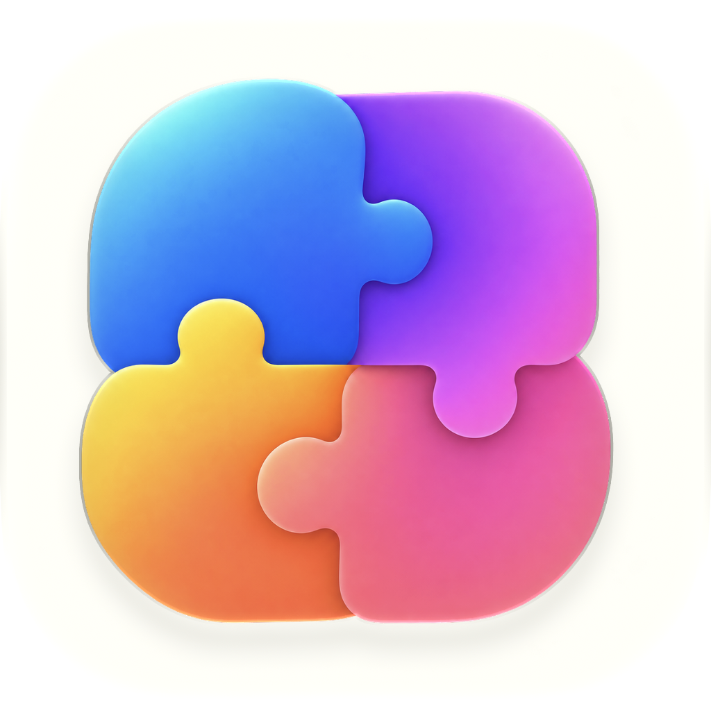

<div align="center">
  
  <h1>Buckle</h1>
  <p>Tus herramientas habituales de Mac, a un clic.</p>
  <p><a href="../README.md">English</a> · <a href="README.zh-CN.md">简体中文</a> · <a href="README.zh-TW.md">繁體中文</a> · <a href="README.ja.md">日本語</a> · <a href="README.ko.md">한국어</a> · <a href="README.de.md">Deutsch</a> · <a href="README.fr.md">Français</a> · <strong>Español</strong></p>
</div>

Buckle es una app nativa de macOS en la barra de menús que reúne herramientas del sistema, inicio de navegadores en otro idioma y acciones habituales del Finder. Funciona en segundo plano sin icono en el Dock.

**[Descargar para macOS](https://github.com/SlippinDylan/Buckle/releases/latest)** · [Guía de desarrollo](development.md)

> [!NOTE]
> Este README describe el código fuente actual. Consulta los cambios y las limitaciones de cada versión descargada en sus notas de publicación.

## Instalación y primer uso

Requiere **macOS 15 o posterior**, en Apple Silicon o Intel. Las compilaciones de CI tienen como destino Universal 2.

1. Descarga `Buckle-<version>.dmg` desde **Assets** de la [última versión en GitHub](https://github.com/SlippinDylan/Buckle/releases/latest). Los archivos del código fuente son para desarrollo, no son instaladores.
2. Para actualizar, elige primero «Salir» en el menú de Buckle y espera a que termine. Abre el DMG y arrastra `Buckle.app` a «Aplicaciones», reemplazando la copia anterior si es necesario.
3. Abre `/Applications/Buckle.app`. Buckle aparece en la barra de menús sin icono en el Dock. Mantén una sola copia instalada.
4. Usa las herramientas o activa las acciones del Finder desde la barra de menús. Las cuatro acciones están desactivadas al principio; tus selecciones se guardan.
5. Activa la extensión del Finder o concede los permisos solicitados en **Ajustes → Permisos**. El estado se actualiza automáticamente; el texto verde y una marca indican acceso concedido o una extensión activa.

La guía de configuración aparece una vez durante un inicio normal si aún no la has cerrado o completado, también para los usuarios existentes, cuyos ajustes se conservan. Presenta la barra de menús y permite elegir acciones de Finder, sus permisos, el inicio de sesión y la búsqueda automática de actualizaciones. Los cambios se guardan de inmediato. Las cuatro acciones de Finder permanecen desactivadas hasta que las elijas. Puedes continuar sin conceder permisos, cerrar la ventana; la guía no se volverá a abrir automáticamente al reiniciar o actualizar. Si un usuario nuevo omite la elección de actualizaciones, la búsqueda automática permanece desactivada. Se conservan las preferencias existentes y las compilaciones que admiten actualizaciones siguen permitiendo la búsqueda manual. La página final aparece en la misma ventana; el botón para empezar abre el menú de Buckle. Los permisos aparecen en una página separada antes de las funciones; puedes continuar sin concederlos.

> [!IMPORTANT]
> Las compilaciones usan firma ad hoc y no están notarizadas. Una versión descargada puede necesitar autorización en Ajustes del Sistema; tras una actualización puede ser necesario volver a conceder permisos.

La instalación mediante Homebrew aún no está disponible. Usa el DMG hasta que el Cask de Buckle se publique en el [Tap compartido](https://github.com/SlippinDylan/homebrew-tap).

## Funciones

<table>
  <tr>
    <td width="36%"><strong>Herramientas del sistema en la barra de menús</strong><br><br>Abre la ventana de memoria del sistema, restablece utilidades del ratón con progreso y resultado, o reinicia la barra de menús del sistema. Cada acción del Finder se activa por separado; una marca indica que está activada.</td>
    <td width="64%" align="center"></td>
  </tr>
  <tr>
    <td width="36%"><strong>Acciones directamente en el Finder</strong><br><br>Añade AirDrop, Abrir en Terminal, Copiar ruta y Trasladar ítems aquí al menú contextual del Finder. Abre Terminal en la carpeta seleccionada o actual y copia varias rutas en líneas separadas.</td>
    <td width="64%" align="center"></td>
  </tr>
  <tr>
    <td width="36%"><strong>Inicia navegadores en ocho idiomas</strong><br><br>Elige un navegador instalado y después un idioma. Buckle detecta los navegadores compatibles cada vez que abres el menú. La app los inicia directamente, sin scripts personales.</td>
    <td width="64%" align="center"></td>
  </tr>
</table>

## Ajustes

Configura el inicio de sesión y el idioma en **Ajustes → General**. La interfaz sigue macOS por defecto. Puedes elegir inglés, chino simplificado o tradicional, japonés, coreano, alemán, francés o español. Reinicia Buckle para aplicar el cambio de idioma.

En **Ajustes → Restablecimiento**, añade o elimina apps y configura la espera antes de reabrirlas entre 0 y 60 segundos, con 3 segundos de forma predeterminada. Los cambios se guardan automáticamente; la edición se desactiva durante un restablecimiento.

<p align="center">
  
  
</p>

Las capturas muestran la interfaz en inglés y pueden diferir de tu versión instalada. Los menús dependen de los navegadores, las acciones activadas y los archivos copiados.

## Antes de usar las herramientas

- **Ventana de memoria:** abre manualmente macOS LowMemoryPanel, incluso con un uso normal de memoria. Su aviso integrado no es un diagnóstico de Buckle. Utiliza una ruta privada de depuración del sistema. Buckle comprueba la ventana específica de advertencia de memoria, restaura el ajuste temporal e informa del error si no puede confirmarla. La compatibilidad debe probarse en cada versión de macOS. Requiere Accesibilidad y automatización de System Events; no supervisa la memoria en segundo plano.
- **Restablecer ratón:** gestiona la lista en **Ajustes → Restablecimiento**. Inicialmente incluye Moom, MonitorControl, BetterMouse e iShot Pro. En cada operación se cierran las aplicaciones de la lista que estén en ejecución, se actualizan los servicios compartidos de preferencias y permisos del sistema de macOS y se vuelven a abrir esas aplicaciones. Solo se vuelven a abrir las aplicaciones que ya estaban en ejecución. Actualizar los servicios puede afectar brevemente a otras aplicaciones y requiere autorización de administrador. Se omiten las aplicaciones desinstaladas; los servicios se actualizan incluso con la lista vacía. La lista de recuperación se guarda. Tras una interrupción, Buckle ofrece volver a abrir las aplicaciones en el siguiente inicio; elegir «Más tarde» conserva el registro.
- **Reiniciar la barra de menús:** reinicia el SystemUIServer del usuario actual sin sudo. Puede que no solucione los iconos gestionados por otras apps.
- **Perfiles del navegador:** utiliza los datos existentes y las sesiones guardadas del navegador, sin crear un perfil independiente. La selección entre varios perfiles sigue el comportamiento del navegador. Cierra el navegador antes de cambiar su idioma de inicio. Si ya está abierto, Buckle solo muestra un aviso. Al iniciar en japonés se solicita la zona horaria de Tokio para el proceso del navegador, como en el script original; los demás idiomas conservan la zona del sistema. No cambia los ajustes de macOS ni la IP, ni garantiza el idioma o los formatos regionales de los sitios. El comportamiento de la zona horaria solo se ha comprobado con Chrome Beta.
- **Finder:** la extensión copia las rutas como texto sin formato, una por línea; las demás acciones inician Buckle cuando hace falta. Para mover archivos, cópialos en el Finder y haz clic derecho en la carpeta de destino o en su fondo. Buckle abre esa carpeta en Finder y activa su comando nativo de traslado. Se requieren permisos de Accesibilidad y Automatización para Finder y System Events. Finder gestiona el progreso, los conflictos de nombres y Deshacer; consulta sus cuadros de diálogo para conocer el resultado. Buckle no espera a que termine la transferencia. Finder determina la posición del menú. Los textos propios de Buckle en el menú de Finder siguen el idioma de la app tras reiniciarla; el nombre nativo de AirDrop sigue el sistema. La página de permisos muestra por separado los accesos de automatización a Finder y System Events. Si se personalizan los atajos de menú de Finder o globales, el traslado automático se desactiva para evitar ejecutar otro comando. Usa Finder directamente.
- **AirDrop:** abre la interfaz de compartir del sistema sin esperar a que termine la transferencia. Solo puede haber una sesión de AirDrop abierta a la vez; las demás acciones del Finder siguen disponibles. Buckle no retrasa su cierre por AirDrop; mantenlo abierto mientras uses la ventana de compartir.
- **Actualizaciones:** Sparkle está integrado. La comprobación manual está en **Ajustes → Acerca de**, y la automática en **General**. Las compilaciones de desarrollo, las validaciones CI y los paquetes de prueba desactivan las actualizaciones; las compilaciones oficiales Release las activan. Con el empaquetado activado, una compilación CI completa y correcta en main empaqueta y publica automáticamente una versión aún no publicada y después sincroniza el feed firmado y el Cask de Homebrew. Los cambios limitados a documentación o archivos auxiliares no publican versiones. Las actualizaciones en línea requieren un instalador publicado y un feed firmado.

## Compilar desde el código fuente

<details>
<summary>Mostrar los pasos de compilación y desarrollo</summary>

Requiere Xcode 26 o posterior, Node.js y Python 3. No se necesita una cuenta de desarrollador de Apple para Debug.

```bash
git clone https://github.com/SlippinDylan/Buckle.git
cd Buckle
bash Scripts/check.sh
bash Scripts/build.sh Debug
```

Después de compilar, elige uno de los dos procedimientos siguientes.

### Instalar para el uso diario

Cierra Buckle con **Salir** en su menú de la barra de menús y espera a que termine. En el Finder, mueve toda la app `Buckle.app` desde `build/DerivedData/Build/Products/Debug/` a `/Applications`. Si sustituyes una copia existente, ciérrala primero. Abre `/Applications/Buckle.app` y mantén una sola copia instalada.

### Ejecutar para desarrollo

Cierra cualquier Buckle en ejecución con **Salir** y espera a que termine antes de ejecutar el comando de abajo. También puedes abrir después `Buckle.xcodeproj` y ejecutar el scheme `Buckle` en Debug. Buckle solo permite una instancia en ejecución: el proceso nuevo se cierra si otra copia sigue activa. Durante el desarrollo, usa la compilación que quieras probar sin abrir a la vez la copia instalada.

```bash
open build/DerivedData/Build/Products/Debug/Buckle.app
```

</details>

## Documentación de desarrollo

La [guía de desarrollo](development.md) (en chino) incluye arquitectura, comprobaciones, paquetes CI, actualizaciones, firma y pruebas en Mac. Los instaladores publicados están en [GitHub Releases](https://github.com/SlippinDylan/Buckle/releases); las [notas de versión](../CHANGELOG.md) se mantienen en inglés.
