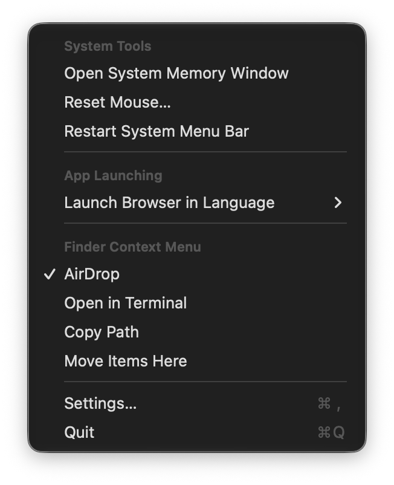

<div align="center">
  
  <h1>Buckle</h1>
  <p>자주 쓰는 Mac 도구를 메뉴 막대에.</p>
  <p><a href="../README.md">English</a> · <a href="README.zh-CN.md">简体中文</a> · <a href="README.zh-TW.md">繁體中文</a> · <a href="README.ja.md">日本語</a> · <strong>한국어</strong> · <a href="README.de.md">Deutsch</a> · <a href="README.fr.md">Français</a> · <a href="README.es.md">Español</a></p>
</div>

Buckle은 시스템 도구, 언어별 브라우저 실행, 자주 쓰는 Finder 작업을 모은 macOS 네이티브 메뉴 막대 앱입니다. Dock 아이콘 없이 백그라운드에서 실행됩니다.

> [!NOTE]
> Buckle 0.1.0은 아직 공개 설치 파일이 없습니다. 아래 안내에 따라 소스에서 빌드하세요.

## 주요 기능

<table>
  <tr>
    <td width="36%"><strong>메뉴 막대에서 시스템 도구 실행</strong><br><br>시스템 메모리 윈도우를 열고, 진행 상황과 결과를 보며 마우스 유틸리티를 재설정하거나, 시스템 메뉴 막대를 재시작하세요. Finder 기능은 개별적으로 켜고 끌 수 있으며 체크 표시는 활성 상태를 뜻합니다.</td>
    <td width="64%" align="center"></td>
  </tr>
  <tr>
    <td width="36%"><strong>Finder에서 바로 작업</strong><br><br>AirDrop, 터미널에서 열기, 경로 복사, ‘여기로 항목 이동’을 Finder의 컨텍스트 메뉴에 추가합니다. 선택한 폴더나 현재 폴더에서 터미널을 열며, 여러 경로는 줄바꿈으로 구분해 복사합니다.</td>
    <td width="64%" align="center"></td>
  </tr>
  <tr>
    <td width="36%"><strong>8개 언어로 브라우저 실행</strong><br><br>설치된 브라우저를 고른 다음 언어를 선택하세요. 메뉴를 열 때마다 지원 브라우저를 감지합니다. 앱 코드로 직접 실행하므로 개인 스크립트를 설정할 필요가 없습니다.</td>
    <td width="64%" align="center"></td>
  </tr>
</table>

### 설정

**설정 → 일반**에서 로그인 시 실행과 앱 언어를 관리합니다. 기본값은 시스템 언어이며 영어, 중국어 간체, 중국어 번체, 일본어, 한국어, 독일어, 프랑스어, 스페인어를 선택할 수 있습니다. 변경 후에는 Buckle을 재시작하세요.

<p align="center">
  
  
</p>

스크린샷은 영어 인터페이스입니다. 메뉴는 설치된 브라우저, 활성화한 기능, 복사한 파일에 따라 달라집니다.

## 설치 및 첫 사용

Apple Silicon 또는 Intel Mac의 **macOS 15 이상**이 필요합니다. CI 빌드 대상은 Universal 2입니다.

1. 아래 소스 빌드 및 설치 절차를 따른 뒤 `/Applications`에 설치한 앱을 여세요.
2. 메뉴 막대 아이콘을 눌러 도구를 쓰거나 Finder 기능을 켜세요. Finder 기능 4개는 처음에는 모두 꺼져 있으며 이후 선택은 저장됩니다.
3. **설정 → 권한**에서 Finder 확장 프로그램을 활성화하거나 필요한 접근 권한을 허용하세요. 상태는 자동 갱신되며 녹색 텍스트와 체크 표시는 허용 또는 활성 상태를 뜻합니다.

빌드는 ad-hoc 서명을 사용하며 공증되지 않았습니다. 다운로드한 빌드는 시스템 설정에서 실행 허용이 필요할 수 있고, 업데이트 후 권한을 다시 부여해야 할 수 있습니다.

## 사용 전 알아둘 점

- **메모리 윈도우:** 메모리 사용량이 정상일 때도 macOS LowMemoryPanel을 수동으로 엽니다. 내장된 메모리 부족 메시지는 Buckle의 진단이 아닙니다. 비공개 시스템 디버그 경로를 사용하며, 해당 메모리 경고 윈도우를 확인하고 임시 설정을 복원합니다. 확인하지 못하면 오류를 알립니다. 각 macOS 버전에서 실기기 호환성 확인이 필요합니다. 손쉬운 사용 및 System Events 자동화 권한이 필요하며 백그라운드 모니터링은 하지 않습니다.
- **마우스 재설정:** 설정 → 마우스 재설정에서 앱 목록을 관리합니다. 기본 목록은 Moom, MonitorControl, BetterMouse, iShot Pro입니다. 실행할 때마다 목록에서 실행 중인 앱을 종료하고 macOS 공유 환경설정 및 시스템 권한 서비스를 새로 고친 다음 앱을 다시 엽니다. 원래 실행 중이던 앱만 다시 엽니다. 서비스 새로 고침은 다른 앱에 잠시 영향을 줄 수 있으며 관리자 인증이 필요합니다. 삭제된 앱은 건너뛰며 목록이 비어 있어도 서비스는 새로 고칩니다. 복구 대기 목록은 저장됩니다. 작업이 중단되면 다음 실행 시 앱을 다시 열지 묻고, 나중에를 선택하면 기록을 유지합니다.
- **시스템 메뉴 막대 재시작:** sudo 없이 현재 사용자의 SystemUIServer를 재시작합니다. 다른 앱이 관리하는 아이콘 문제는 해결되지 않을 수 있습니다.
- **브라우저 프로필:** 별도 프로필을 만들지 않고 브라우저의 기존 데이터와 저장된 로그인 상태를 사용합니다. 여러 프로필 중 선택은 브라우저 자체 동작을 따릅니다. 실행 언어를 바꾸기 전에 브라우저를 종료하세요. 이미 실행 중이면 Buckle은 안내만 표시합니다. IP 주소나 시간대는 바뀌지 않으며 웹사이트의 표시 언어도 보장하지 않습니다.
- **Finder:** 경로 복사는 확장 프로그램에서 처리하고 다른 작업은 필요할 때 Buckle을 실행합니다. 이동하려면 Finder에서 파일을 복사한 뒤 대상 폴더 또는 빈 공간을 우클릭하세요. 이동은 확인이 필요하며 기존 항목을 덮어쓰지 않고 Finder 실행 취소와 연동되지 않습니다. 중간에 실패해도 완료된 이동은 유지됩니다. 재시도 전 양쪽 폴더를 확인하세요. 메뉴 위치는 Finder가 결정합니다. Buckle이 제공하는 Finder 메뉴 문구는 Buckle 재시작 후 앱 언어를 따르며, 기본 AirDrop 이름은 시스템 언어를 따릅니다.
- **업데이트:** Sparkle이 통합되어 있습니다. 수동 확인은 **설정 → 정보**, 자동 확인은 **일반**에 있습니다. 개발 및 풀 리퀘스트 빌드는 업데이트를 비활성화하고 main의 CI 릴리스 빌드는 활성화하며, 온라인 업데이트에는 공개 설치 파일과 서명된 피드가 필요합니다.

## 소스에서 빌드

Xcode 26 이상, Node.js, Python 3이 필요합니다. Debug 빌드에는 Apple 개발자 계정이 필요 없습니다.

```bash
git clone https://github.com/SlippinDylan/Buckle.git
cd Buckle
bash Scripts/check.sh
bash Scripts/build.sh Debug
```

빌드 후 용도에 따라 아래 두 방법 중 하나를 선택하세요.

### 일상적으로 사용할 버전 설치

실행 중인 Buckle의 메뉴 막대 메뉴에서 **종료**를 선택하고 종료될 때까지 기다리세요. Finder에서 `build/DerivedData/Build/Products/Debug/`의 `Buckle.app` 전체를 `/Applications`로 옮기세요. 기존 버전을 대치할 때도 먼저 종료하세요. `/Applications/Buckle.app`을 열고 설치된 앱은 하나만 유지하세요.

### 개발용 빌드 실행

실행 중인 Buckle을 **종료**로 닫고 종료될 때까지 기다린 다음 아래 명령을 실행하세요. 또는 기존 앱을 종료한 뒤 `Buckle.xcodeproj`를 열고 `Buckle` scheme을 Debug로 실행하세요. Buckle은 한 인스턴스만 실행할 수 있습니다. 다른 복사본이 실행 중이면 새 프로세스는 종료됩니다. 개발 중에는 테스트할 빌드를 사용하고 설치된 복사본을 동시에 열지 마세요.

```bash
open build/DerivedData/Build/Products/Debug/Buckle.app
```

## 개발 문서

빌드 검사, CI, 패키징, 업데이트 배포, 서명 및 실기기 검증 목록은 [개발 가이드](development.md)(중국어 간체)를 참고하세요. 공개 설치 파일은 추후 [GitHub Releases](https://github.com/SlippinDylan/Buckle/releases)에 게시됩니다.
