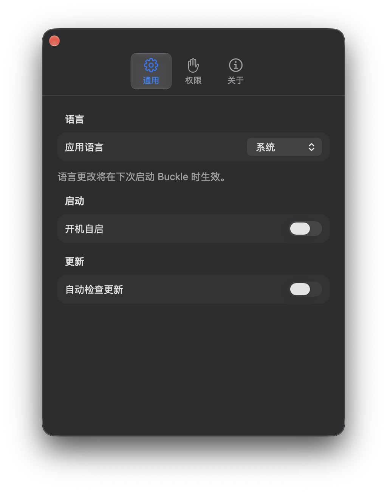

<div align="center">
  
  <h1>Buckle</h1>
  <p>자주 쓰는 Mac 도구를 메뉴 막대에.</p>
  <p><a href="../README.md">English</a> · <a href="README.zh-CN.md">简体中文</a> · <a href="README.zh-TW.md">繁體中文</a> · <a href="README.ja.md">日本語</a> · <strong>한국어</strong> · <a href="README.de.md">Deutsch</a> · <a href="README.fr.md">Français</a> · <a href="README.es.md">Español</a></p>
</div>

Buckle은 시스템 도구, 언어별 브라우저 실행, 자주 쓰는 Finder 작업을 모은 macOS 네이티브 메뉴 막대 앱입니다. Dock 아이콘 없이 백그라운드에서 실행됩니다.

**[macOS 버전 다운로드](https://github.com/SlippinDylan/Buckle/releases/latest)** · [개발 가이드](development.md)

> [!NOTE]
> 이 README는 현재 소스 코드의 기능을 설명합니다. 다운로드한 버전의 변경 사항과 제한은 해당 릴리스 설명을 확인하세요.

## 설치 및 첫 사용

Apple Silicon 또는 Intel Mac의 **macOS 15 이상**이 필요합니다. CI 빌드 대상은 Universal 2입니다.

1. [GitHub 최신 릴리스](https://github.com/SlippinDylan/Buckle/releases/latest)의 **Assets**에서 `Buckle-<version>.dmg`를 다운로드하세요. 소스 코드 압축 파일은 개발용이며 설치 파일이 아닙니다.
2. 업데이트할 때는 실행 중인 Buckle 메뉴에서 「종료」를 선택하고 종료될 때까지 기다리세요. DMG를 열어 `Buckle.app`을 「응용 프로그램」으로 드래그하고 필요하면 이전 버전을 교체하세요.
3. `/Applications/Buckle.app`을 여세요. Buckle은 Dock 아이콘 없이 메뉴 막대에 표시됩니다. 설치된 앱은 하나만 유지하세요.
4. 메뉴 막대에서 도구를 사용하거나 Finder 우클릭 기능을 켜세요. 다섯 가지 Finder 기능은 처음에 모두 꺼져 있으며 이후 선택이 저장됩니다.
5. 「설정 → 권한」에서 Finder 확장 프로그램을 활성화하거나 필요한 접근 권한을 부여하세요. 상태는 자동 갱신되며 녹색 글자와 체크 표시는 권한 부여 또는 활성화 상태를 나타냅니다.

설정 가이드를 아직 닫거나 완료하지 않았다면 일반 실행 시 한 번 표시됩니다. 기존 사용자에게도 표시되지만 현재 설정은 유지됩니다. 가이드에서 메뉴 막대 사용법, Finder 동작과 필요한 권한, 로그인 시 실행, 자동 업데이트 확인을 설정할 수 있습니다. 변경 사항은 즉시 저장되며, 다섯 가지 Finder 동작은 직접 선택하기 전까지 꺼진 상태로 유지됩니다. 권한을 허용하지 않고도 계속할 수 있습니다. 윈도우를 닫으면 재실행하거나 업그레이드해도 자동으로 다시 열리지 않습니다. 새 사용자가 업데이트 설정을 건너뛰면 자동 확인은 꺼진 상태로 유지됩니다. 기존 업데이트 환경설정은 보존되며, 업데이트를 지원하는 빌드에서는 수동 확인도 계속 사용할 수 있습니다. 마지막에 같은 윈도우에 설정 완료 페이지가 표시되며, 사용 시작 버튼으로 Buckle 메뉴를 열 수 있습니다. 권한은 기능 스위치 앞의 별도 페이지에서 확인하며, 허용하지 않고 계속할 수도 있습니다.

> [!IMPORTANT]
> 빌드는 ad-hoc 서명을 사용하며 공증되지 않았습니다. 다운로드한 빌드는 시스템 설정에서 실행 허용이 필요할 수 있고, 업데이트 후 권한을 다시 부여해야 할 수 있습니다.

Homebrew 설치는 아직 제공되지 않습니다. [공유 Tap](https://github.com/SlippinDylan/homebrew-tap)에 Buckle Cask가 공개되기 전까지 DMG를 사용하세요.

## 제거 및 재설치

메뉴에서 Buckle을 종료하고 종료될 때까지 기다린 다음 `Buckle.app`을 휴지통으로 이동하세요. 앱만 삭제하면 설정과 가이드 기록이 남으므로 덮어쓰거나 재설치해도 가이드가 다시 표시되지 않습니다.

재설치 후 가이드를 다시 표시하려면 Buckle을 종료한 뒤 터미널에서 다음 명령도 실행하세요.

```bash
defaults delete studio.slippindylan.Buckle onboarding.dismissed
```

이 명령은 가이드를 닫은 기록만 삭제하며 다른 설정, Finder 데이터 및 시스템 권한은 유지합니다. 기록이 없다는 메시지가 나오면 삭제할 것이 없습니다. 재설치 후 Buckle을 직접 실행하면 가이드가 한 번 표시됩니다. 일반 업데이트 시에는 실행하지 마세요.

## 주요 기능

<table>
  <tr>
    <td width="36%"><strong>메뉴 막대에서 시스템 도구 실행</strong><br><br>시스템 메모리 윈도우를 열고, 진행 상황과 결과를 보며 마우스 유틸리티를 재설정하거나, 시스템 메뉴 막대를 재시작하세요. Finder 기능은 개별적으로 켜고 끌 수 있으며 체크 표시는 활성 상태를 뜻합니다.</td>
    <td width="64%" align="center"></td>
  </tr>
  <tr>
    <td width="36%"><strong>Finder에서 바로 작업</strong><br><br>AirDrop, 터미널에서 열기, 경로 복사, ‘여기로 항목 이동’, 새 텍스트 파일을 Finder의 컨텍스트 메뉴에 추가합니다. 선택한 폴더나 현재 폴더에서 터미널을 열며, 여러 경로는 줄바꿈으로 구분해 복사합니다.</td>
    <td width="64%" align="center"></td>
  </tr>
  <tr>
    <td width="36%"><strong>8개 언어로 브라우저 실행</strong><br><br>설치된 브라우저를 고른 다음 언어를 선택하세요. 메뉴를 열 때마다 지원 브라우저를 감지합니다. 앱 코드로 직접 실행하므로 개인 스크립트를 설정할 필요가 없습니다.</td>
    <td width="64%" align="center"></td>
  </tr>
</table>

네 가지 사용자 지정 Finder 동작은 Finder와 Buckle 메뉴 막대 메뉴에서 같은 컬러 아이콘을 사용하며, AirDrop은 시스템 아이콘을 유지합니다.

**새 텍스트 파일:** 메뉴 막대나 설정 가이드에서 켠 다음 일반 폴더 하나 또는 배경을 우클릭하세요. Buckle은 현지화된 이름의 빈 `.txt` 파일을 만들고, 이름이 겹치면 번호를 붙여 덮어쓰지 않으며 Finder에서 선택합니다. Finder 확장이 필요하지만 추가 손쉬운 사용이나 자동화 권한은 필요하지 않습니다. 자동 이름 변경과 Finder 기본 실행 취소는 제공하지 않습니다.

## 설정

**설정 → 일반**에서 로그인 시 실행과 앱 언어를 관리합니다. 기본값은 시스템 언어이며 영어, 중국어 간체, 중국어 번체, 일본어, 한국어, 독일어, 프랑스어, 스페인어를 선택할 수 있습니다. 변경 후에는 Buckle을 재시작하세요.

「설정 → 일반 → Dock」에서 「가운데 클릭으로 앱 종료」를 켠 뒤(기본값 꺼짐), Dock에서 실행 중인 앱 아이콘을 가운데 클릭하세요. 메뉴 막대에도 연동되는 활성화 스위치가 있습니다. 「가운데 클릭 동작」 하위 메뉴에서 「일반 종료」(기본값)나 「강제 종료…」를 선택하면 저장되어 클릭마다 동작 메뉴를 열지 않고 적용됩니다. 정상 종료는 저장 확인이나 취소를 허용합니다. 강제 종료는 매번 저장하지 않은 변경 사항이 손실될 수 있다는 경고와 함께 확인하며, 취소하면 아무 동작도 하지 않습니다. 확인 후 같은 앱 인스턴스를 다시 검증하여 해당 앱만 강제 종료합니다. 모든 보조 프로세스를 종료하거나 자동으로 강제 종료로 전환하거나 재시도하지 않으며 추가 권한도 필요하지 않습니다. Finder, Dock, WindowManager, Buckle은 제외됩니다. 손쉬운 사용 권한이 필요하며 마우스 필터를 시작할 수 없으면 설정에서 입력 모니터링 권한을 명시적으로 요청할 수 있습니다. 드래그로는 종료되지 않으며, 아이콘 식별 중 빠른 첫 클릭은 시스템으로 전달될 수 있습니다. 이 두 새 기능은 설치된 빌드와 지원 macOS에서 실기기 검증이 필요합니다. macOS 15는 최소 대상 버전이며 호환성 검증 결과가 아닙니다.

「설정 → 마우스 재설정」에서 앱을 추가·제거하고 다시 열기 전 대기 시간을 0–60초로 설정할 수 있습니다. 기본값은 3초입니다. 변경은 자동 저장되며 초기화 중에는 편집할 수 없습니다.

<p align="center">
  
  
</p>

스크린샷은 영어 화면이며 설치된 버전과 다를 수 있습니다. 메뉴는 설치된 브라우저, 활성화한 기능, 복사한 파일에 따라 달라집니다.

## 사용 전 알아둘 점

- **메모리 윈도우:** 메모리 사용량이 정상일 때도 macOS LowMemoryPanel을 수동으로 엽니다. 내장된 메모리 부족 메시지는 Buckle의 진단이 아닙니다. 비공개 시스템 디버그 경로를 사용하며, 해당 메모리 경고 윈도우를 확인하고 임시 설정을 복원합니다. 확인하지 못하면 오류를 알립니다. 각 macOS 버전에서 실기기 호환성 확인이 필요합니다. 손쉬운 사용 및 System Events 자동화 권한이 필요하며 백그라운드 모니터링은 하지 않습니다.
- **마우스 재설정:** 설정 → 마우스 재설정에서 앱 목록을 관리합니다. 기본 목록은 Moom, MonitorControl, BetterMouse, iShot Pro입니다. 실행할 때마다 목록에서 실행 중인 앱을 종료하고 macOS 공유 환경설정 및 시스템 권한 서비스를 새로 고친 다음 앱을 다시 엽니다. 원래 실행 중이던 앱만 다시 엽니다. 서비스 새로 고침은 다른 앱에 잠시 영향을 줄 수 있으며 관리자 인증이 필요합니다. 삭제된 앱은 건너뛰며 목록이 비어 있어도 서비스는 새로 고칩니다. 복구 대기 목록은 저장됩니다. 작업이 중단되면 다음 실행 시 앱을 다시 열지 묻고, 나중에를 선택하면 기록을 유지합니다.
- **시스템 메뉴 막대 재시작:** sudo 없이 현재 사용자의 SystemUIServer를 재시작합니다. 다른 앱이 관리하는 아이콘 문제는 해결되지 않을 수 있습니다.
- **브라우저 프로필:** 별도 프로필을 만들지 않고 브라우저의 기존 데이터와 저장된 로그인 상태를 사용합니다. 여러 프로필 중 선택은 브라우저 자체 동작을 따릅니다. 실행 언어를 바꾸기 전에 브라우저를 종료하세요. 이미 실행 중이면 Buckle은 안내만 표시합니다. 일본어로 실행할 때는 원본 스크립트처럼 브라우저 프로세스에 도쿄 시간대를 지정하며, 다른 언어는 시스템 시간대를 유지합니다. macOS 설정이나 IP 주소는 변경하지 않으며 사이트 언어나 지역 형식도 보장하지 않습니다. 시간대 동작은 Chrome Beta에서만 확인했습니다.
- **Finder:** 경로 복사는 확장 프로그램에서 일반 텍스트로 처리하며 여러 경로는 줄바꿈으로 구분합니다. 다른 작업은 필요할 때 Buckle을 실행합니다. 외장 드라이브, 디스크 이미지 및 기타 마운트된 볼륨의 Finder 사이드바 아이콘을 Buckle이 덮어쓰지 않도록 Finder 동작은 시동 볼륨에만 적용됩니다. 이동하려면 Finder에서 파일을 복사한 뒤 대상 폴더 또는 빈 공간을 우클릭하세요. Buckle이 Finder에서 대상 폴더를 열고 기본 이동 명령을 실행합니다. 손쉬운 사용 및 Finder와 System Events 제어를 위한 자동화 권한이 필요합니다. 진행 상황, 이름 충돌 및 실행 취소는 Finder가 처리하므로 시스템 대화상자에서 결과를 확인하세요. Buckle은 전송 완료를 기다리지 않습니다. 메뉴 위치는 Finder가 결정합니다. Buckle이 제공하는 Finder 메뉴 문구는 Buckle 재시작 후 앱 언어를 따르며, 기본 AirDrop 이름은 시스템 언어를 따릅니다. 권한 페이지는 Finder와 System Events의 자동화 권한을 각각 표시합니다. 다른 명령이 실행되는 것을 막기 위해 Finder 또는 전역 메뉴 단축키가 사용자 지정된 경우 자동 이동을 실행하지 않습니다. Finder에서 직접 작업하세요.
- **AirDrop:** 시스템 공유 화면을 열고 전송 완료를 기다리지 않습니다. AirDrop 세션은 한 번에 하나만 열 수 있으며 다른 Finder 동작은 계속 사용할 수 있습니다. Buckle은 AirDrop 때문에 종료를 미루지 않습니다. 공유 창을 사용하는 동안 Buckle을 실행 상태로 유지하세요.
- **업데이트:** Sparkle이 통합되어 있습니다. 수동 확인은 **설정 → 정보**, 자동 확인은 **일반**에 있습니다. 개발, CI 검증 및 테스트 패키지는 업데이트를 비활성화하며 정식 Release 빌드는 활성화합니다. 패키징이 활성화되어 있으면 main의 전체 CI 빌드 성공 후 아직 공개되지 않은 버전을 자동으로 패키징하고 공개한 다음 서명된 업데이트 피드와 Homebrew Cask를 동기화합니다. 문서나 보조 파일만 변경한 경우에는 공개하지 않습니다. 온라인 업데이트에는 공개된 설치 파일과 서명된 피드가 필요합니다.

## 소스에서 빌드

<details>
<summary>소스 빌드 및 개발 절차 펼치기</summary>

Xcode 26 이상, Node.js, Python 3이 필요합니다. Debug 빌드에는 Apple 개발자 계정이 필요 없습니다.

```bash
git clone https://github.com/SlippinDylan/Buckle.git
cd Buckle
bash Scripts/check.sh
bash Scripts/build.sh Debug
```

빌드 후 용도에 따라 아래 두 방법 중 하나를 선택하세요.

### 일상적으로 사용할 버전 설치

실행 중인 Buckle의 메뉴 막대 메뉴에서 **종료**를 선택하고 종료될 때까지 기다리세요. Finder에서 `build/DerivedData/Build/Products/Debug/`의 `Buckle.app` 전체를 `/Applications`로 옮기세요. 기존 버전을 대치할 때도 먼저 종료하세요. `/Applications/Buckle.app`을 열고 설치된 앱은 하나만 유지하세요.

### 개발용 빌드 실행

실행 중인 Buckle을 **종료**로 닫고 종료될 때까지 기다린 다음 아래 명령을 실행하세요. 또는 기존 앱을 종료한 뒤 `Buckle.xcodeproj`를 열고 `Buckle` scheme을 Debug로 실행하세요. Buckle은 한 인스턴스만 실행할 수 있습니다. 다른 복사본이 실행 중이면 새 프로세스는 종료됩니다. 개발 중에는 테스트할 빌드를 사용하고 설치된 복사본을 동시에 열지 마세요.

```bash
open build/DerivedData/Build/Products/Debug/Buckle.app
```

</details>

## 개발 문서

[개발 가이드](development.md)(중국어)에서 구조, 검사, CI 패키징, 업데이트 배포, 서명, 실제 기기 검증을 확인할 수 있습니다. 배포된 설치 파일은 [GitHub Releases](https://github.com/SlippinDylan/Buckle/releases), 영어 변경 내역은 [릴리스 설명](../CHANGELOG.md)을 참고하세요.
