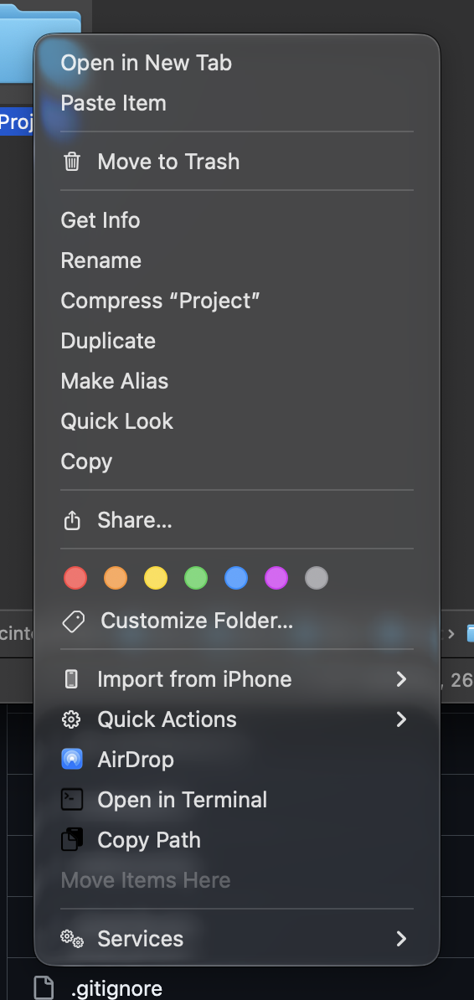

<div align="center">
  
  <h1>Buckle</h1>
  <p>把常用的 Mac 小工具，收进菜单栏。</p>
  <p><a href="../README.md">English</a> · <strong>简体中文</strong> · <a href="README.zh-TW.md">繁體中文</a> · <a href="README.ja.md">日本語</a> · <a href="README.ko.md">한국어</a> · <a href="README.de.md">Deutsch</a> · <a href="README.fr.md">Français</a> · <a href="README.es.md">Español</a></p>
</div>

Buckle 是原生 macOS 菜单栏工具，提供系统工具、按语言启动浏览器，以及常用的访达右键操作。后台运行，不显示 Dock 图标。

> [!NOTE]
> Buckle 0.1.0 尚无公开安装包，请按下方说明从源码构建。

## 功能一览

<table>
  <tr>
    <td width="36%"><strong>系统工具，点击即用</strong><br><br>手动打开系统内存窗口，查看鼠标重置的进度与结果，或重启系统菜单栏。访达功能可分别开启和关闭，勾选表示已开启。</td>
    <td width="64%" align="center"></td>
  </tr>
  <tr>
    <td width="36%"><strong>在访达里直接操作</strong><br><br>将隔空投送、在终端中打开、复制路径、将项目移到这里加入访达右键菜单。在选中的文件夹或当前目录打开终端；多条路径按行复制。</td>
    <td width="64%" align="center"></td>
  </tr>
  <tr>
    <td width="36%"><strong>按八种语言启动浏览器</strong><br><br>先选本机浏览器，再选语言。每次打开菜单都会重新检测受支持的浏览器，由应用代码直接启动，无需配置个人脚本。</td>
    <td width="64%" align="center"></td>
  </tr>
</table>

### 设置

在「设置 → 通用」管理开机自启和应用语言。默认跟随系统，也可选择英语、简体中文、繁体中文、日语、韩语、德语、法语或西班牙语。更改语言后需重启 Buckle。

<p align="center">
  
  
</p>

截图统一展示英文界面。菜单会随已安装的浏览器、已启用的功能及已拷贝的文件变化。

## 安装与首次使用

需要 **macOS 15 或更新版本**，支持 Apple Silicon 和 Intel；CI 构建目标为 Universal 2。

1. 按下方源码构建与安装步骤操作，再从 `/Applications` 打开已安装的应用。
2. 点击菜单栏图标使用工具，或开启访达右键功能。四项访达功能首次使用时默认关闭，之后会保留选择。
3. 打开「设置 → 权限」启用访达扩展或授予所需权限。状态自动刷新；绿色文字和勾选表示已授权或已启用。

构建采用 ad-hoc 签名，未经公证。下载的构建可能需要在系统设置中允许运行；更新后可能需要重新授权。

## 使用前须知

- **系统内存窗口：**手动打开 macOS LowMemoryPanel，内存正常时也能使用。窗口自带的“应用程序内存不足”文字不代表实际诊断结果。此功能使用私有系统调试路径，兼容性可能随系统版本变化。需要辅助功能和控制 System Events 的自动化权限；不后台监测内存。
- **重置鼠标：**刷新相关服务，仅重启原本正在运行的受支持工具：Moom、MonitorControl、BetterMouse、iShot Pro。需要管理员权限时由 macOS 弹出授权提示。
- **重启系统菜单栏：**重启当前用户的 SystemUIServer，无需 sudo；不保证修复其他应用自行管理的图标。
- **浏览器配置：**Chromium 系浏览器按语言使用独立配置，不复用日常登录状态。Safari 需先退出再切换语言。此功能不改变 IP 或时区，也不保证网站使用所选语言。
- **访达操作：**复制路径由扩展直接完成，其他操作按需启动 Buckle。移动时先在访达拷贝文件，再右键目标文件夹或空白处。移动需确认，不覆盖已有项目，也不接入访达撤销历史；中途失败时已完成的移动会保留，请检查源、目标两处再重试。菜单位置由访达决定。
- **更新：**已接入 Sparkle，手动检查在「设置 → 关于」，自动检查开关在「通用」。开发与 CI 测试构建禁用更新；在线更新需先发布安装包和签名更新清单。

## 从源码构建

需要 Xcode 26 或更新版本、Node.js、Python 3。Debug 构建无需 Apple 开发者账号。

```bash
git clone https://github.com/SlippinDylan/Buckle.git
cd Buckle
bash Scripts/check.sh
bash Scripts/build.sh Debug
```

构建完成后，按用途选择以下一种方式。

### 安装日常使用的版本

先在已运行 Buckle 的菜单栏菜单中选择「退出」，等待应用结束。在访达中，将 `build/DerivedData/Build/Products/Debug/` 下的整个 `Buckle.app` 移入 `/Applications`；如需替换已有版本，也先退出再替换。打开 `/Applications/Buckle.app`，保留一份已安装的应用。

### 开发时运行构建结果

先通过「退出」关闭已有 Buckle，等待应用结束，再执行下方命令。也可以在退出已有应用后，打开 `Buckle.xcodeproj`，运行 `Buckle` scheme 的 Debug 配置。Buckle 只允许一个实例运行：已有实例未退出时，新启动的进程会退出。开发时使用正在测试的构建，不要同时打开安装目录中的副本。

```bash
open build/DerivedData/Build/Products/Debug/Buckle.app
```

## 开发文档

[开发指南](development.md)包含构建检查、CI、打包、更新发布、签名与实机验收清单。未来公开安装包将发布到 [GitHub Releases](https://github.com/SlippinDylan/Buckle/releases)。
